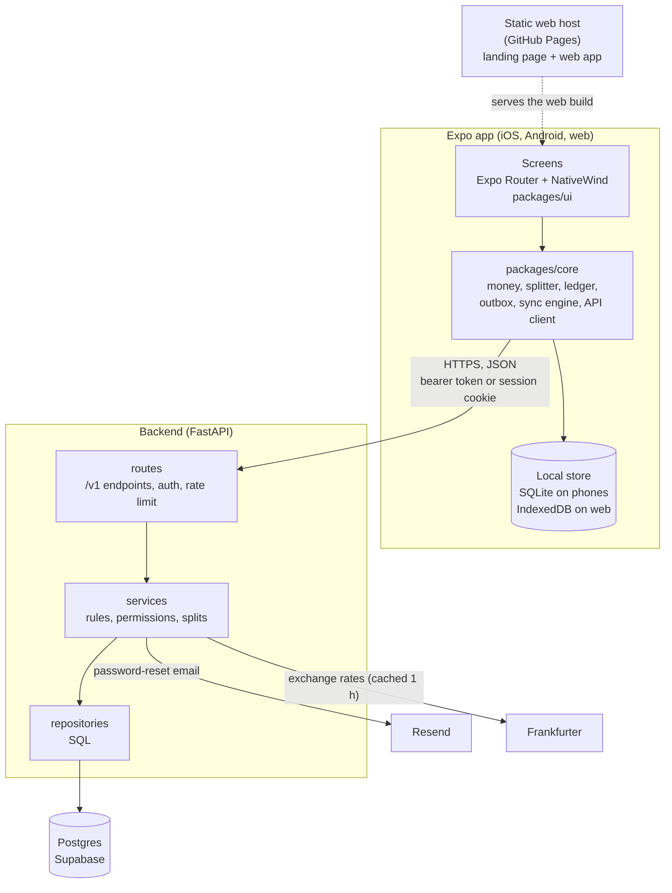
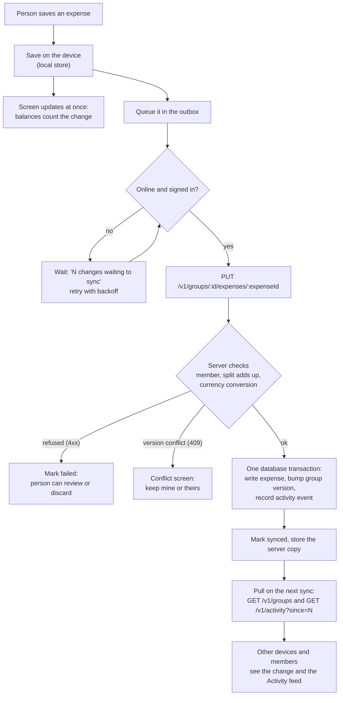

# CommonTab

[](https://github.com/chaturved/CommonTab/actions/workflows/ci.yml)

CommonTab splits shared expenses with friends. One TypeScript app (Expo) runs on iOS, Android and the web. It works offline: every change is saved on the device first and sent to the server in the background. An account is required. The server is a FastAPI service on Postgres.

The cross-platform rebuild is tracked in [PROGRESS.md](PROGRESS.md). The original SwiftUI app is kept in `legacy/ios` as a reference.

## What it does

- Groups with people who do or do not have an account; invite by code or link.
- Expenses split equally, by exact amount, by percent or by item, in whole cents (never floats), including expenses in another currency with the rate saved on the expense.
- Balances, settle up, simplify debts, edit conflicts when two people change the same expense, an Activity feed, group leave, archive and delete.
- Works without a connection; a status chip shows what is waiting to sync.
- Account screens: sign in, create account, password reset by email, change name or password, delete account, export CSV.
- A landing page at the web root, a desktop layout with a sidebar, and phone layouts.

## How it works

### Components



### Saving an expense (offline-first)



More diagrams (opening the app and routes) and the layering rules are in [docs/architecture.md](docs/architecture.md).

### Design decisions and trade-offs

- **Offline-first.** The UI never waits on the network. A change is saved on the device, then goes through an outbox that retries with backoff. The cost is that the client has to model "waiting", "failed" and "conflict" states, and the screens show them.
- **Safe retries.** The client picks every id (expense, payment, group, person), and the writes are `PUT` or idempotent. Repeating a request that already succeeded returns the same record and writes nothing, including no second activity event. Reusing an id for a different payment, or an id that belongs to another group, is a `409`.
- **Conflicts are explicit.** Each expense has a `version`. A write with a stale version gets `409 version_conflict` and the person chooses which version to keep; the other is filed in the expense's history. Last-write-wins would lose edits silently.
- **Money is integer cents.** No floats anywhere. Remainders are shared out deterministically (request order for equal splits, largest remainder for percentages), so a bill always adds up exactly. The TypeScript and Python code run the same JSON fixtures in `fixtures/money`, so both give the same cents.
- **The server is the authority for shared state.** It checks membership, that a split adds up, that a payment does not exceed what is owed (under a lock on the group), and that a foreign-currency amount matches its rate. Clients can compute balances immediately, and the server's numbers win on the next sync.
- **Foreign currency.** The expense stores the original amount, its currency and the rate (an integer, millionths) next to the amount in the group's currency, so balances never change when rates move. Rates come through the backend (cached for an hour, with a fallback to the last rate the device saw when offline) and not from the apps.
- **Activity feed.** Events are written in the same transaction as the change. Clients pull with a sequence cursor (`since=N`), so a device only fetches what is new and the feed is cheap to poll.
- **Sessions.** An httpOnly cookie for browsers and a bearer token for everything else. A write that authenticates by cookie must also carry a custom header, which a page on another site cannot add (CSRF protection). A `401` always means the session ended, so wrong-password cases return `403`.
- **Layered backend.** Routes, then services, then repositories, with one database transaction per request. Rules live in services and SQL in repositories, so unit tests mock the repositories and integration tests hit a real Postgres.
- **Deletes keep history.** Expenses are tombstoned (so other devices learn about the deletion), and a group is soft-deleted; people who leave or are removed stay in old expenses.

What it does not do yet, and what I would do next: host the API (it needs a long-running server, HTTPS and backups); the rate limiter is in memory, so it only works for one instance (a shared store such as Redis would be needed to scale out); the web build is a single-page app, so the landing page's text is not in the HTML; receipt scanning, recurring expenses and push notifications are out of scope for the first version.

## Repository layout

```text
frontend/          TypeScript npm workspace
  packages/core    Pure TypeScript: money, splitter, ledger, outbox, sync engine, API client
  packages/ui      Design tokens and components (NativeWind)
  apps/app         Expo app for iOS, Android and web
backend/           FastAPI service (package app), Alembic migrations, tests
fixtures/money/    Shared JSON cases used by the core and backend tests
docs/              Architecture, API contract, design docs (docs/design)
legacy/ios/        SwiftUI app, Xcode project and Swift tests (reference only)
scripts/           Repository utilities
```

The high-level design, with flowcharts, is in [docs/architecture.md](docs/architecture.md). The HTTP contract is in [docs/shared-api.md](docs/shared-api.md), and the running API serves `/openapi.json`. Scope and screens: [docs/design/SPEC.md](docs/design/SPEC.md) and the other files in `docs/design`.

## Run it locally

**Requirements:** Node 24, Python 3.11 or newer, and a Postgres database (a free Supabase project works).

1. API, from `backend/`:

   ```sh
   python3 -m venv .venv
   .venv/bin/python -m pip install -e '.[test]'
   cp .env.example .env        # set DATABASE_URL
   .venv/bin/alembic upgrade head
   .venv/bin/uvicorn app.main:app --reload
   ```

   `http://localhost:8000/healthz` should answer `{"status":"ok"}`. Password-reset codes are printed in the API log unless `RESEND_API_KEY` is set. More in [backend/README.md](backend/README.md).

2. App, from `frontend/`:

   ```sh
   npm ci
   cd apps/app
   npm run web        # browser, at http://localhost:8081
   npm start          # Expo dev server for a phone or simulator
   ```

   The app reads the API address from `EXPO_PUBLIC_API_URL` (default `http://localhost:8000`).

## Tests

```sh
cd backend  && .venv/bin/python -m pytest -q tests/unit        # no database
cd backend  && .venv/bin/python -m pytest -q -n 4 tests        # needs TEST_DATABASE_URL
cd frontend && npm run typecheck && npm test
```

CI (`.github/workflows/ci.yml`) runs the backend tests against Postgres, the frontend type check and tests, a web export, and the legacy iOS builds and tests.

## Deploying

The web app is a single-page build that any static host can serve; `.github/workflows/web.yml` publishes it to GitHub Pages from `main`. Setup steps and notes on hosting are in [frontend/apps/app/README.md](frontend/apps/app/README.md). The API deploys to Render from `render.yaml` (steps in [backend/README.md](backend/README.md#deploy-on-render)); it needs `DATABASE_URL`, Resend keys and `ALLOWED_ORIGINS`, and it is not deployed yet.

## Legacy iOS app

`legacy/ios` holds the original SwiftUI app. Open `legacy/ios/CommonTab.xcodeproj` in Xcode (Swift 6, iOS 18 or newer SDK) and run the `CommonTab` scheme, or run `swift test --package-path legacy/ios`. It is kept for reference, mainly its money and ledger tests, which the TypeScript code reproduces as golden tests.

## License

Copyright 2026 Chaturved Lakkaraju. All rights reserved. This project is proprietary; see [LICENSE](LICENSE) for terms.

## Rename compatibility

The legacy iOS bundle identifier, Keychain service names and on-device expense archive path keep their SplitTip values so an installed app can keep reading existing data. The API also keeps `SPLITTIP_METRICS_TOKEN`.
