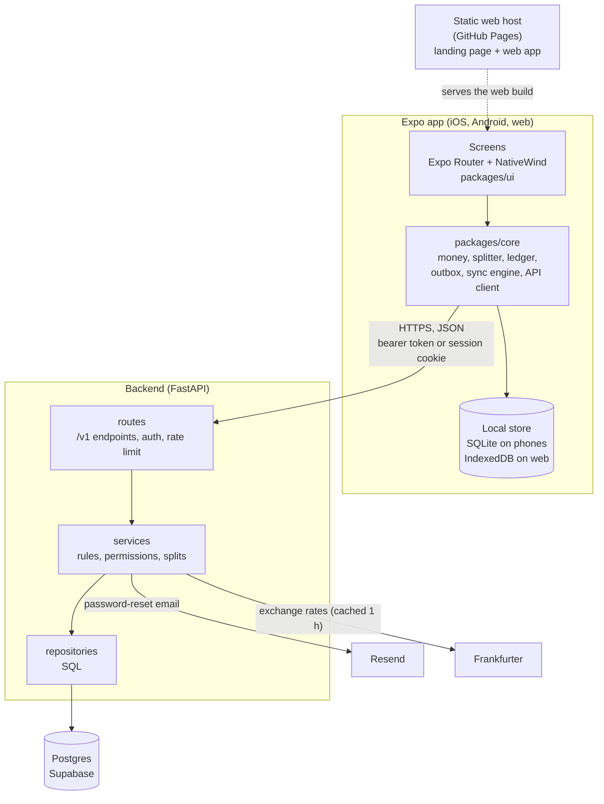
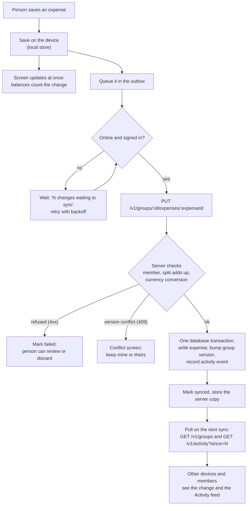
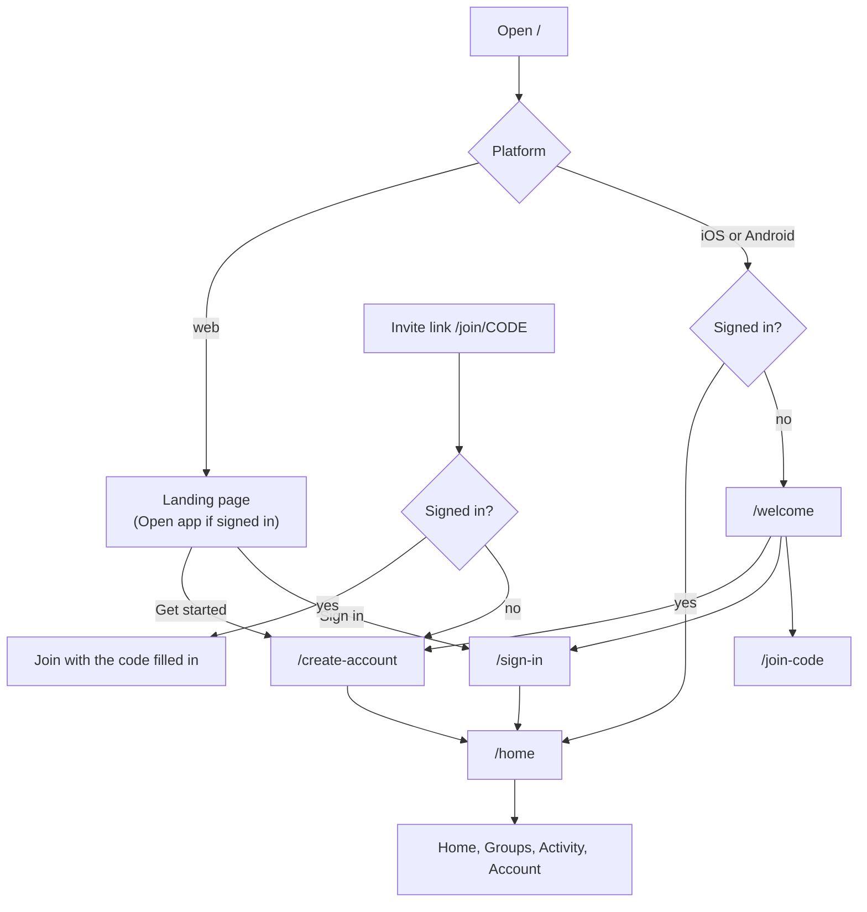

# Architecture

CommonTab splits shared expenses. One TypeScript app (Expo) runs on iOS, Android and the web. It is offline-first: every change is saved on the device first and sent to the API in the background. The API (FastAPI and Postgres) owns the shared state: accounts, groups, expenses, payments and the activity feed.

The original SwiftUI app is kept under `legacy/ios` as a reference; its notes are at the end of this file.

## High-level design

### Components



The shared API contract is in [shared-api.md](shared-api.md). Money is always integer minor units (cents); `packages/core` and the backend share the fixtures in `fixtures/money` so the same inputs give the same cents.

### Saving an expense (offline-first)



Retrying a request is safe: the expense id is chosen on the device, and repeating the same write changes nothing.

### Opening the app



Signed-in and signed-out screens live in separate route groups; the session decides which group is reachable, so a signed-out visit to `/home` lands on the front door.

## Project layout

```text
frontend/                 TypeScript npm workspace
  packages/core/          Pure TypeScript: money, splitter, ledger, outbox, sync, API client, view models
  packages/ui/            Design tokens and components (NativeWind)
  apps/app/               Expo app for iOS, Android and web (landing page at the web root)
backend/
  app/                    API routes, services, repositories, schemas
  migrations/             Alembic migrations
  tests/                  unit and integration (real Postgres) tests
fixtures/money/           Shared JSON cases used by core and backend tests
docs/                     Architecture, API contract, design docs
legacy/ios/               SwiftUI app and Swift tests (reference only)
scripts/                  Repository utilities
```

## Legacy iOS app: dependency boundaries

- `legacy/ios/CommonTab/Domain` is independent of SwiftUI and persistence. Swift money math, itemized calculations, validation, and local models live here.
- `legacy/ios/CommonTab/Application` coordinates local archive and receipt repository interfaces. `Data/Local` implements storage and keeps credentials in the Keychain.
- `legacy/ios/CommonTab/Data/Remote` owns HTTP transport and API DTOs. Group expenses, temporary bill sessions, exchange rates, and analytics have separate clients. Views create requests and display server results; they do not compute authoritative shared balances.
- `legacy/ios/CommonTab/Features` owns SwiftUI navigation and form state. The four root tabs are Overview, Groups, Expenses, and Tools. Screens are grouped by workflow; `Shared` owns reusable presentation components, while editors and details have their own files.
- `backend/app` is layered. `main.py` builds the app; `api/routes/` has one router module per resource and each class declares what it needs with `Depends` in `__init__` (services take repositories, repositories take the request's connection from `get_db`, which is one database transaction), and `api/deps.py` has bearer-token auth and the rate limit. `services/` holds the rules, `repositories/` the SQL, `schemas/` the request and response models. `domain/rules.py` contains money allocation and balance rules. `core/errors.py` defines the shared API error response.
- The web app is the Expo app exported as a static site (`npm run export:web` in `frontend/apps/app`): one HTML file per route, with the landing page's content in `index.html`. `/` is the landing page and `/home` is Home. Routes with a parameter (`/join/CODE`, `/group/ID`) have no file of their own, so a host must send them to a fallback page; see `frontend/apps/app/README.md`.

## Cross-platform contract (legacy notes)

The server owns shared group money rules. Clients send integer minor units, a split method, participants in an explicit order, and optional exact-minor-unit or percentage inputs. The server allocates any remainder deterministically and returns each member's share and balance. Group currencies are restricted to USD, EUR, GBP, CAD, AUD, JPY, and INR so future clients can agree on fraction digits. See [shared API](shared-api.md) and the generated `/openapi.json` schema.

Shared expense edits carry the current expense version. A stale edit returns `409` and must be reloaded. Settlement writes carry the current group version. Receipts are available only to group members, are limited to JPEG or PNG under 5 MB, and are never part of anonymous analytics. The iOS app keeps the account bearer token in the Keychain.

Local groups use named members without accounts. They remain separate from shared groups because names cannot safely identify server users. Import transfers an expense amount, description, category, notes, and optional receipt after the user chooses real group members. It does not silently merge local membership or itemized mappings.

## Operational limits

The API uses Postgres with Alembic migrations and in-memory rate limiting, which suits one API instance. The current code does not include email delivery, password reset, push notifications, or hosted monitoring. A public service needs HTTPS termination, backups, and operational monitoring. These limits are documented so the app does not imply that local data is automatically synced.

The HTTP contract can support a future React Native client or a shared-group browser client without sharing Swift source code. The current browser app does not use the API.
